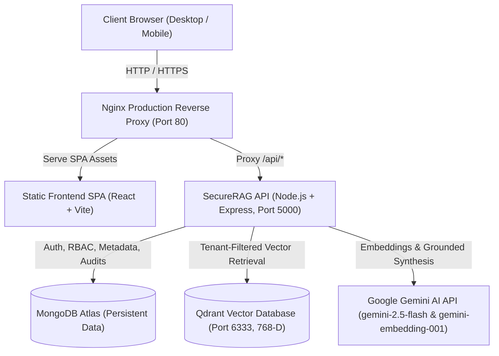

# SecureRAG — Enterprise Knowledge Governance & Secure AI Document Intelligence Platform

[](https://github.com/organization/securerag/actions)


-brightgreen)

**SecureRAG** is a production-grade, multi-tenant enterprise knowledge governance and AI document intelligence platform. It features Retrieval-Augmented Generation (RAG) powered by Google Gemini, Qdrant vector database, MongoDB Atlas, strict Zero-Trust Role-Based Access Control (RBAC), multi-format document ingestion (PDF, DOCX, TXT, Markdown), document intelligence (summarization, side-by-side comparison, technology stack extraction), immutable cryptographic audit trails, and production Dockerization.

---

## 1. System Architecture



### Technology Matrix
- **Frontend**: React 19, Vite 8, Tailwind CSS v4, Lucide React, Recharts, React Router DOM v7
- **Reverse Proxy**: Nginx 1.27 Alpine (SPA fallback, gzip, 50MB uploads, security headers, extended timeouts)
- **Backend**: Node.js 20 LTS, Express 4.x (ES Modules), Helmet, CORS allowlisting, express-rate-limit
- **Persistence**: MongoDB Atlas (live cluster) with automated resilient fallback
- **Vector Engine**: Qdrant Vector DB with cosine similarity, 768-D vectors, and tenant payload indexing
- **AI Models**: Google GenAI SDK (`@google/genai`) using `gemini-2.5-flash` and `gemini-embedding-001`
- **Document Extractors**: `pdf-parse-new` (PDF), `mammoth` (DOCX), native buffer decoder (TXT, Markdown)
- **Security & RBAC**: JWT (access tokens & HttpOnly cookies), bcrypt hashing (10 rounds), request ID tracing (`X-Request-Id`)

---

## 2. Prerequisites

- **Node.js**: `v20.x LTS` or higher
- **npm**: `v9.x` or higher
- **Docker & Docker Compose**: Docker Desktop on Windows/macOS or Docker Engine on Linux
- **MongoDB Atlas Cluster**: A free or dedicated Atlas MongoDB cluster URI
- **Google Gemini API Key**: Acquired from [Google AI Studio](https://aistudio.google.com/)

---

## 3. Environment Variable Configuration

Create `.env` files based on the provided templates. **Never commit `.env` files containing credentials to version control.**

### Root `.env` (for Docker Compose and Global Config)
```ini
# --- Runtime ---
NODE_ENV=production
PORT=5000

# --- Database Credentials ---
MONGODB_URI=mongodb+srv://<username>:<password>@cluster0.xxxxx.mongodb.net/securerag?retryWrites=true&w=majority
ALLOW_MEMORY_DB=false

# --- Security ---
JWT_SECRET=generate_a_secure_random_string_with_at_least_32_characters

# --- Google Gemini AI ---
GEMINI_API_KEY=AIzaSy...your_gemini_api_key
GEMINI_MODEL=gemini-2.5-flash
GEMINI_EMBEDDING_MODEL=gemini-embedding-001
EMBEDDING_DIMENSION=768

# --- Qdrant Vector DB ---
# Inside Docker Compose bridge network, use the service hostname:
QDRANT_URL=http://qdrant:6333
QDRANT_COLLECTION=securerag_chunks

# --- CORS & Client Origin ---
CLIENT_ORIGIN=http://localhost,http://localhost:80,http://localhost:5173

# --- Frontend Build Arg ---
VITE_API_URL=/api
```

---

## 4. Running the Complete Application with Docker Compose

SecureRAG includes complete Docker configurations with multi-stage builds and unprivileged users.

### Quickstart (Full Stack: Frontend, Backend, Qdrant)
```bash
# 1. Clone repository
git clone https://github.com/organization/securerag.git
cd securerag

# 2. Configure environment
cp .env.example .env
# Edit .env with your MONGODB_URI, JWT_SECRET, and GEMINI_API_KEY

# 3. Build and launch all services
docker compose up --build -d
```

Once running:
- **Web Application**: [`http://localhost:80`](http://localhost:80)
- **Backend Health Check**: [`http://localhost:5000/api/health`](http://localhost:5000/api/health)
- **Qdrant Dashboard**: [`http://localhost:6333/dashboard`](http://localhost:6333/dashboard)

### Production Lockdown Mode
To run without exposing internal backend (`5000`) and Qdrant (`6333`) ports to host network:
```bash
docker compose -f docker-compose.yml -f docker-compose.prod.yml up --build -d
```
In this mode, all traffic enters exclusively through Nginx on port `80`, routing `/api/*` requests internally to the backend container.

### Stopping Services
```bash
docker compose down
# To stop and preserve persistent vector volume:
docker compose down
# To completely reset vector storage:
docker compose down -v
```

---

## 5. Running Locally for Development (Without Docker)

### Step 1: Start Qdrant
```bash
# Start standalone Qdrant container with persistent volume
docker run -d -p 6333:6333 -p 6334:6334 -v qdrant_storage:/qdrant/storage --name securerag-qdrant qdrant/qdrant:v1.13.2
```

### Step 2: Start the Backend API
```bash
cd backend
npm install
# Ensure backend/.env contains your GEMINI_API_KEY and MONGODB_URI
npm start
```
*Backend listens on `http://localhost:5000`.*

### Step 3: Start Frontend Dev Server
```bash
cd ..
npm install
npm run dev
```
*Frontend runs on `http://localhost:5173` with Vite HMR.*

---

## 6. Default Pre-Seeded Enterprise Personas

The initial seed process automatically creates 3 test roles:

| Name | Role | Email | Password | Access Scope |
|---|---|---|---|---|
| **Sarah Connor** | **Admin** | `admin@novacorp.com` | `SecurePass123!` | Complete administrative access, user/org management, all document classifications. |
| **David Vance** | **Manager** | `manager@novacorp.com` | `SecurePass123!` | Departmental scope: Public, Internal, and Confidential documents. |
| **Elena Rostova** | **Employee** | `elena@novacorp.com` | `SecurePass123!` | Public & Internal documents only. Access to Confidential or Restricted documents is blocked. |

---

## 7. Health Checks, Logging & Monitoring

### Subsystem Health Endpoint
```bash
curl http://localhost:5000/api/health
```
**Sample Output:**
```json
{
  "status": "healthy",
  "service": "SecureRAG AI Backend API",
  "version": "2.0.0",
  "uptime": 1420.5,
  "ragReady": true,
  "subsystems": {
    "database": { "status": "connected", "mode": "atlas", "host": "cluster0.xxxxx.mongodb.net" },
    "embedding": { "status": "connected", "mode": "gemini", "dimension": 768 },
    "vectorStore": { "status": "connected", "mode": "real_qdrant", "collection": "securerag_chunks", "dimension": 768 },
    "gemini": { "status": "connected", "mode": "gemini_api", "model": "gemini-2.5-flash" }
  }
}
```

### Viewing Logs
```bash
# View backend application logs
docker compose logs -f backend

# View reverse proxy access and error logs
docker compose logs -f frontend

# View Qdrant vector database logs
docker compose logs -f qdrant
```

All incoming requests receive an immutable `X-Request-Id` header (e.g. `req_172942...`), which is attached to all server-side error logs and audit events for end-to-end tracing.

---

## 8. Automated Testing & Verification

### Executing Backend Test Suite (75 Tests)
```bash
cd backend
npm test
```
**Test Coverage Includes:**
- System health & subsystem diagnostics
- Authentication, JWT verification, and cookie security
- Role-based authorization & document clearance enforcement
- Multi-format ingestion (PDF `%PDF-` verification, DOCX, TXT)
- Corrupted and 0-byte file rejection
- Semantic vector retrieval, top-K scoring, and citation generation
- Honest model abstention when knowledge is absent
- Structured technology-stack extraction
- Phase 8 document intelligence (summarization, comparison, entity extraction)
- Multi-tenant data and vector isolation
- In-document adversarial prompt injection defense
- End-to-end complete user journey execution

### Running RAG Evaluation Benchmark (8 Evaluation Cases)
```bash
cd backend
npm run eval
```
Evaluates retrieval precision, citation accuracy, anti-hallucination, and zero data leakage.

### Frontend Production Build Test
```bash
npm run build
```

---

## 9. Backup and Disaster Recovery Strategy

### 1. MongoDB Atlas Persistent Data
- **Automated Cloud Backups**: Configure Continuous Cloud Backups (PITR) in MongoDB Atlas with point-in-time recovery.
- **Manual Export**:
  ```bash
  mongodump --uri="<MONGODB_URI>" --out="./backup/mongo_$(date +%Y%m%d)"
  ```
- **Restore**:
  ```bash
  mongorestore --uri="<MONGODB_URI>" "./backup/mongo_<timestamp>/securerag"
  ```

### 2. Qdrant Vector Database
- **Named Docker Volume Backup**:
  ```bash
  docker run --rm -v qdrant_storage:/data -v $(pwd)/backups:/backup alpine tar czf /backup/qdrant_backup_$(date +%Y%m%d).tar.gz -C /data .
  ```
- **Qdrant Native Snapshot API**:
  ```bash
  # Trigger snapshot creation
  curl -X POST "http://localhost:6333/collections/securerag_chunks/snapshots"
  # Download snapshot
  curl -o securerag_chunks.snapshot "http://localhost:6333/collections/securerag_chunks/snapshots/<snapshot-name>"
  ```
- **Reindexing Fallback**: SecureRAG persists original document metadata in MongoDB Atlas. If Qdrant storage is ever lost, the admin can trigger automated reindexing via `POST /api/documents/:id/reindex`.

---

## 10. Troubleshooting Guide

| Issue | Cause | Resolution |
|---|---|---|
| `querySrv ECONNREFUSED` | Local ISP / Windows router DNS fails SRV lookups for `mongodb+srv://` | Backend automatically adds fallback Google/Cloudflare DNS (`8.8.8.8`, `1.1.1.1`). Verify outbound port 27017 is open. |
| `Qdrant connection refused: http://localhost:6333` | Backend running in Docker container trying to reach `localhost` | In Docker Compose, the backend must use `http://qdrant:6333`. `localhost` refers to the container itself. |
| `CORS blocked request` | Origin of client does not match `CLIENT_ORIGIN` | Update `CLIENT_ORIGIN` in `.env` to include the client domain, e.g. `http://localhost,http://localhost:80,https://mycorp.com`. |
| `Gemini HTTP 429 Too Many Requests` | Exceeded 20 requests/minute on Gemini free tier | Ingest documents in smaller batches or upgrade to a pay-as-you-go Gemini API key in Google AI Studio. |
| `Port 5000 or 80 already in use` | Another local process or web server is occupying the port | Check port with `netstat -ano | findstr :5000` or change port mapping in `docker-compose.yml`. |

---

## 11. Cloud Deployment Guidelines

### Option A: AWS ECS / Fargate or GCP Cloud Run
1. Build and push container images to Amazon ECR or Google Artifact Registry:
   ```bash
   docker build -t <account-id>.dkr.ecr.<region>.amazonaws.com/securerag-backend:latest -f backend/Dockerfile backend/
   docker build -t <account-id>.dkr.ecr.<region>.amazonaws.com/securerag-frontend:latest -f Dockerfile .
   docker push ...
   ```
2. Deploy backend service with environment variables passed via AWS Secrets Manager or GCP Secret Manager.
3. Deploy Qdrant using Qdrant Cloud managed service or an ECS service with an Amazon EFS persistent volume.
4. Set backend `QDRANT_URL` to the Qdrant Cloud / internal ALB endpoint.
5. Direct domain traffic to the frontend through AWS CloudFront / Application Load Balancer with an AWS Certificate Manager (ACM) SSL/TLS certificate.

### Option B: Render / Railway / DigitalOcean App Platform
1. Connect GitHub repository to Render/Railway.
2. Configure **Backend Web Service**:
   - Build command: `npm --prefix backend ci`
   - Start command: `node backend/src/server.js`
   - Environment variables: `MONGODB_URI`, `JWT_SECRET`, `GEMINI_API_KEY`, `QDRANT_URL`, `CLIENT_ORIGIN`.
3. Configure **Frontend Static Site**:
   - Build command: `npm run build`
   - Publish directory: `dist`
   - Environment variable: `VITE_API_URL=https://your-backend-service.onrender.com/api`
4. Deploy managed Qdrant via Qdrant Cloud or a Docker service with persistent volume attached.

---

## 12. Security & Compliance Highlights

- **Zero-Trust Retrieval**: Vector database queries filter strictly on caller `organizationId` and authorized document IDs before semantic matching.
- **Prompt Injection Neutralization**: Injected prompt override attempts inside documents are sandboxed and evaluated strictly as passive reference text.
- **Cryptographic Audit Logs**: Security events calculate SHA-256 integrity hashes across actor, organization, action, resource, and client IP.
- **Error Sanitization**: Production 500 error messages never disclose stack traces, database URIs, or internal implementation details.
- **Strict Content-Type Validation**: Magic-byte signature verification prevents disguised executables or malformed payloads from entering the ingestion pipeline.
